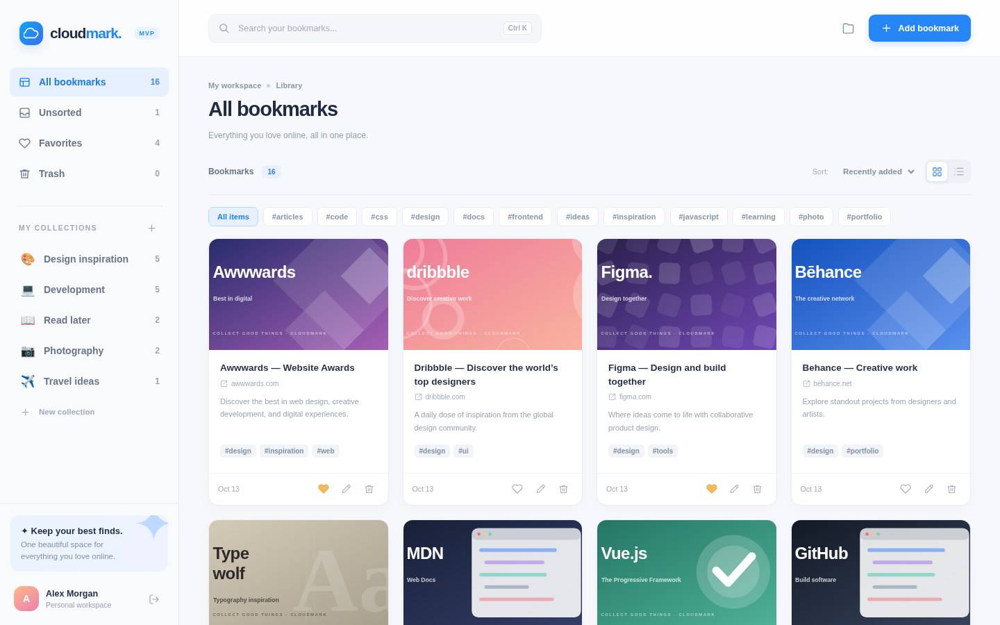
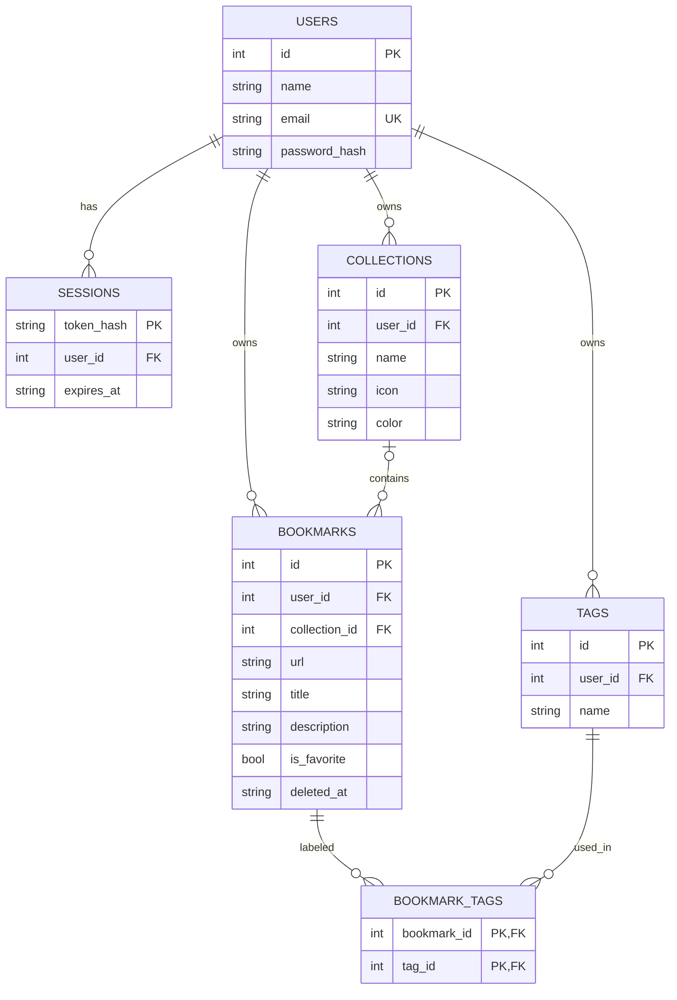

# ☁ Cloudmark — Raindrop.io kloonprojekt

**Autor:** Bogdan Anokhin · **Rühm:** TA-23B  
**Õppeprojekt:** iseseisev kloonprojekt (MVP, andmebaas, frontend ja backend)  
**Originaal:** [Raindrop.io](https://raindrop.io/) — veebipõhine järjehoidjate haldamise süsteem.

> Cloudmark on **iseseisvalt kirjutatud, mitteäriline õppeprojekt**, mis jäljendab Raindrop.io peamisi kasutusvooge ja visuaalset ülesehitust. See **ei ole ametlik Raindrop.io rakendus** ega kasuta originaalteenuse API-d. Nimi ja illustratsioonid on loodud õppeprojekti jaoks.



## 1. Projekti idee

Valisin kloonimiseks **Raindrop.io**, sest see on konkreetse otstarbega ning vähem tavapärane valik kui YouTube, Spotify või Tinder. Tegemist on teenusega, kuhu kasutaja saab salvestada veebilehti, organiseerida need kaustadesse ehk *collections*, lisada silte ja otsida juba salvestatud sisu.

**Probleem, mida süsteem lahendab:** kasutaja leiab veebist palju kasulikke linke ja tahab need ühte kohta korrastatult salvestada, et neid hiljem kiiresti uuesti leida.

**MVP (minimum viable product):** võimalikult väike, aga reaalselt töötav veebirakendus, kus saab registreeruda, sisse logida, salvestada veebiaadresse ja neid hallata.

Täielik MVP kirjeldus ja piirangud: [`docs/MVP_ET.md`](docs/MVP_ET.md).

## 2. Kasutatavad tehnoloogiad

| Osa | Tehnoloogia | Eesmärk |
|---|---|---|
| Frontend | HTML5, CSS3, JavaScript (ES modules) | Kasutajaliides, vormid, filtreerimine ja andmete kuvamine |
| Backend | Node.js 22+ (`node:http`) | REST API, autentimine, äriloogika |
| Andmebaas | SQLite (`node:sqlite`) | Kasutajate, kogude, linkide ja siltide püsiv salvestamine |
| Paroolid | Node.js `crypto` / PBKDF2 + juhuslik sool | Paroolide turvalisem salvestamine |
| Seansid | Juhuslikud seansitokenid + HttpOnly küpsis | Sisselogitud kasutaja tuvastamine |
| Testimine | Node.js `node:test` + `assert` | API integratsioonitestid |

**Projekt ei vaja ühtegi npm-välist sõltuvust.** Node.js 22.13 või uuem on vajalik, kuna projekt kasutab sisseehitatud SQLite moodulit. Node.js 22 võib käivitamisel näidata teadet `ExperimentalWarning: SQLite is an experimental feature` — see on selle Node.js versiooni hoiatusteade, mitte rakenduse viga.

## 3. Kuidas projekti käivitada?

1. Paigalda **Node.js 22.13+**: <https://nodejs.org/>
2. Laadi projekt alla või klooni GitHubi repositoorium.
3. Ava terminal projektikaustas.
4. Sisesta:

```bash
npm start
```

5. Ava brauseris **http://localhost:3000**.

Arendusrežiim (server taaskäivitub failide muutmisel):

```bash
npm run dev
```

Testid:

```bash
npm test
```

Soovi korral saab muuta porti: Linux/macOS `PORT=4000 npm start`, Windows PowerShell `$env:PORT=4000; npm start`.

**Andmebaas luuakse automaatselt** esimesel käivitamisel faili `data/bookmarks.db`. Kui soovid puhtalt alustada, sulge server ja kustuta see fail (koos võimalike `-wal` ja `-shm` lisafailidega).

### Demokonto

- **E-post:** `demo@raindrop.local`
- **Parool:** `Demo12345!`

Selle kontoga luuakse esimesel käivitamisel automaatselt **5 kollektsiooni ja 16 näidisjärjehoidjat**. Sisselogimislehel on nupp **Use demo account**, mis täidab sisselogimise sinu eest.

## 4. Töötavad MVP funktsioonid

- Kasutaja saab **registreeruda, sisse logida ja välja logida**. Eri kasutajad ei näe üksteise linke.
- Kasutaja saab **luua, muuta ja kustutada kollektsioone**. Kustutatud kollektsiooni lingid liiguvad *Unsorted* alla.
- Kasutaja saab **salvestada, muuta ja kustutada veebijärjehoidjaid** (URL, pealkiri, kirjeldus, kollektsioon, sildid, illustratsioon).
- Kasutaja saab muuta lingi **lemmikuks** või eemaldada selle lemmikutest.
- Kustutatud järjehoidja liigub **prügikasti**, kust seda saab taastada või lõplikult kustutada.
- Kasutaja saab **otsida** pealkirja, URL-i, kirjelduse ja siltide järgi.
- Kasutaja saab **filtreerida siltide ja kollektsioonide järgi** ning sortida lisamise kuupäeva või pealkirja alusel.
- Olemas on **kaardi- ja loendivaade**, mobiilivaade ja klaviatuuri otsetee **Ctrl+K** otsinguks.

> Veebilehtede eelvaatepildid on MVP-s käsitsi koostatud näidiskaaned või kasutaja valitud stiilikaardid. Server **ei laadi** võõrastelt saitidelt automaatselt pisipilte, sisu ega metaandmeid. Tegemist ei ole 1:1 Raindrop.io koopiaga.

## 5. Andmebaasi mudel

Andmebaasis on **6 tabelit**:

1. `users` — kasutajakontod;
2. `sessions` — serveripoolsed sisselogimisseansid;
3. `collections` — kasutaja kollektsioonid;
4. `bookmarks` — veebijärjehoidjad;
5. `tags` — märksõnad;
6. `bookmark_tags` — ühendustabel järjehoidjate ja siltide mitmele-mitmega seose jaoks.



**Põhjalikum skeem ja seosed:** [`docs/ANDMEBAAS.md`](docs/ANDMEBAAS.md).  
**SQLite tabelite SQL:** [`docs/schema.sql`](docs/schema.sql).

## 6. REST API näited

| Meetod | URL | Funktsioon |
|---|---|---|
| `POST` | `/api/auth/register` | Registreerumine |
| `POST` | `/api/auth/login` | Sisselogimine |
| `POST` | `/api/auth/logout` | Väljalogimine |
| `GET` | `/api/me` | Aktiivse kasutaja andmed |
| `GET` | `/api/bootstrap` | Kasutaja kogud, järjehoidjad ja sildid |
| `POST` | `/api/collections` | Kollektsiooni loomine |
| `PATCH` | `/api/collections/:id` | Kollektsiooni muutmine |
| `DELETE` | `/api/collections/:id` | Kollektsiooni kustutamine |
| `POST` | `/api/bookmarks` | Järjehoidja loomine |
| `PATCH` | `/api/bookmarks/:id` | Järjehoidja muutmine |
| `DELETE` | `/api/bookmarks/:id` | Prügikasti tõstmine |
| `POST` | `/api/bookmarks/:id/restore` | Taastamine |
| `DELETE` | `/api/bookmarks/:id/permanent` | Lõplik kustutamine |

Kõik järjehoidjate ja kollektsioonide päringud kontrollivad kasutaja õigusi. SQL päringutes on parameetrid, mitte käsitsi stringidesse liidetud kasutajasisend.

## 7. Visuaalne võrdlus originaaliga

Raindrop.io originaalis on vasakul kollektsioonidega külgriba, ülal otsing ning keskel järjehoidjate kaardi- või loendivaade. Cloudmark järgib sama **ülesehitust ja kasutusloogikat**:

- vasakpoolne navigeerimine: All / Unsorted / Favorites / Trash / Collections;
- ülemine otsinguväli ja "Add bookmark" nupp;
- pisipiltidega järjehoidjakaardid, sildid, domeeninimed ja tegevusnupud;
- kollektsioonide ikoonid ning järjehoidjate arvud;
- hele minimalistik kasutajaliides, mida saab kasutada ka telefonis.

Originaali viide: [Raindrop.io](https://raindrop.io/), [kasutajaliidese juhend](https://help.raindrop.io/ui).  
**Minu tehtud kuvatõmmised:** [arvutivaade](dashboard-preview.png) ja [mobiilivaade](mobile-preview.png).

## 8. Testimine

`npm test` käivitab automaatse API integratsioonitesti, mis kontrollib kasutaja autentimist, andmete salvestamist, muutmist, taastamist ja eri kontode eraldatust. Test kasutab eraldi ajutist SQLite andmebaasi ega muuda rakenduse pärisandmeid.

Üksikasjalik testide loend: [`docs/TESTIMINE.md`](docs/TESTIMINE.md).  
Õpetajale esitamise lühikava: [`docs/ESITLUS.md`](docs/ESITLUS.md).

## 9. Kaustade ülesehitus

```text
raindrop-clone/
├── server/
│   ├── index.js           # HTTP server, API, autentimine
│   └── db.js              # SQLite skeem, päringud, demoandmed
├── public/
│   ├── index.html         # Brauseri rakenduse HTML
│   ├── styles.css         # Responsive disain
│   ├── app.js             # Frontend loogika
│   └── assets/            # Projekti enda SVG kaaned ja favicon
├── tests/
│   └── api.test.js        # Automaatne API test
├── docs/
│   ├── MVP_ET.md          # MVP kirjeldus
│   ├── ANDMEBAAS.md       # Andmebaasi disain
│   ├── schema.sql         # SQL skeem
│   ├── TESTIMINE.md       # Testiplaan
│   └── ESITLUS.md         # Esitluse kava
├── dashboard-preview.png  # Töölaua kuvatõmmis
├── mobile-preview.png     # Mobiili kuvatõmmis
├── package.json
└── README.md
```

## 10. MVP piirangud ja edasiarendused

Projekti eesmärk ei ole kogu Raindrop.io toote kloonimine. Selles MVP-s **ei ole** brauserilaiendust, teistega jagatud kollektsioone, veebilehtede automaatset salvestamist võrgu kaudu, sisu täielikku arhiveerimist, AI-otsingut ega pilvesünkroonimist erinevate serverite vahel. Samuti ei ole siin adminpaneeli ega parooli taastamise e-posti.

Võimalikud tulevased täiendused: Open Graph piltide automaatne toomine, drag-and-drop, import/export, täistekstiotsing, pilvemajutus ja testide laiendamine.

**Turvalisus:** MVP sobib lokaalseks õppetööks; avaliku serveri jaoks tuleks lisada HTTPS, päringulimiidid, põhjalikum CSRF-kaitse, e-kirjaga kinnitamine, seansihaldus ja tootmiskeskkonna audit. Demokonto on kõigile teada ning seda ei tohi kasutada pärisandmete hoidmiseks.
